# Althea: a researcher-led workspace for AI-assisted review of qualitative coding

*Technical appendix. Submitted with the proposal and source code to the Organization Science special issue*

> This is the Markdown version of [`Althea_Technical_Appendix.docx`](../Althea_Technical_Appendix.docx), for reading on GitHub. The Word file is the version submitted.

| Item | Details |
|---|---|
| Source code | This repository, supplied with the submission |
| Software version | Althea 1.0.0 (October 2026) |
| Runs on | Windows & macOS; Node.js and a current web browser |
| AI engine | pi coding agent (SDK), with a model provider chosen by the researcher |
| Example data | Two anonymised example exports in the repository: 160 quotations from 92 sources, 10 codes, 174 code assignments. Source: the creatives subset of the [Anthropic Interviewer dataset](https://huggingface.co/datasets/Anthropic/AnthropicInterviewer/viewer/AnthropicInterviewer/creatives). |
| Licence | MIT Licence ([LICENSE](../LICENSE) in the repository). Bundled components keep their own licences: SheetJS (Apache 2.0), Montserrat and Roboto Mono (SIL Open Font License). |

## Contents

- [1. Source code and availability](#1-source-code-and-availability)
- [2. System architecture](#2-system-architecture)
  - [2.1 Components](#21-components)
  - [2.2 How an analysis runs](#22-how-an-analysis-runs)
  - [2.3 Instructions given to the model](#23-instructions-given-to-the-model)
- [3. Installation](#3-installation)
  - [3.1 System requirements](#31-system-requirements)
  - [3.2 Install steps](#32-install-steps)
  - [3.3 Configuring pi: subscriptions, API keys and local models](#33-configuring-pi-subscriptions-api-keys-and-local-models)
  - [3.4 System check](#34-system-check)
  - [3.5 Troubleshooting](#35-troubleshooting)
- [4. Researcher workflow](#4-researcher-workflow)
  - [4.1 Import](#41-import)
  - [4.2 Methodological orientation](#42-methodological-orientation)
  - [4.3 Prepare](#43-prepare)
  - [4.4 Scope](#44-scope)
  - [4.5 Review](#45-review)
  - [4.6 Decide and confirm](#46-decide-and-confirm)
  - [4.7 Codebook and final files](#47-codebook-and-final-files)
  - [4.8 Decision history](#48-decision-history)
  - [4.9 Saving and moving work](#49-saving-and-moving-work)
- [5. Transparency, auditability and reproducibility](#5-transparency-auditability-and-reproducibility)
- [6. Data protection and research ethics](#6-data-protection-and-research-ethics)
- [7. Limitations and planned work](#7-limitations-and-planned-work)

## 1. Source code and availability

The complete source code, example data and documentation are in the repository supplied with this submission. The repository is self-contained: it has no third-party packages to install, and no build step. The table below lists the main files.

| Path | Purpose |
|---|---|
| [`README.md`](../README.md) | How researchers install and use Althea |
| [`AGENTS.md`](../AGENTS.md) | Guide to the code for developers and coding agents |
| [`Althea.md`](../Althea.md) | Product specification: workflow stages, analytical functions, user actions |
| [`Althea_Design_Guidelines.md`](../Althea_Design_Guidelines.md) | Visual and wording rules for the interface |
| [`agent/PI.md`](../agent/PI.md) | Design of the Althea AI integration with the pi agent |
| [`index.html`](../index.html), [`src/`](../src) | The application that runs in the browser (plain JavaScript modules) |
| [`server.mjs`](../server.mjs) | Local web server and the analysis endpoints |
| [`agent/pi-analyst.mjs`](../agent/pi-analyst.mjs) | Althea AI: runs one isolated pi agent session per analysis |
| [`tests/`](../tests) | Automated tests (39) run against the example exports |
| `Example Data - *.xlsx` | Anonymised example ATLAS.ti exports |
| [`vendor/`](../vendor) | Bundled spreadsheet reader (SheetJS) and fonts |

## 2. System architecture

Althea has three parts: the application in the web browser, a small local server, and the Althea AI component, which runs a pi agent session and talks to a model provider. Figure 1 shows how they fit together.

<p align="center">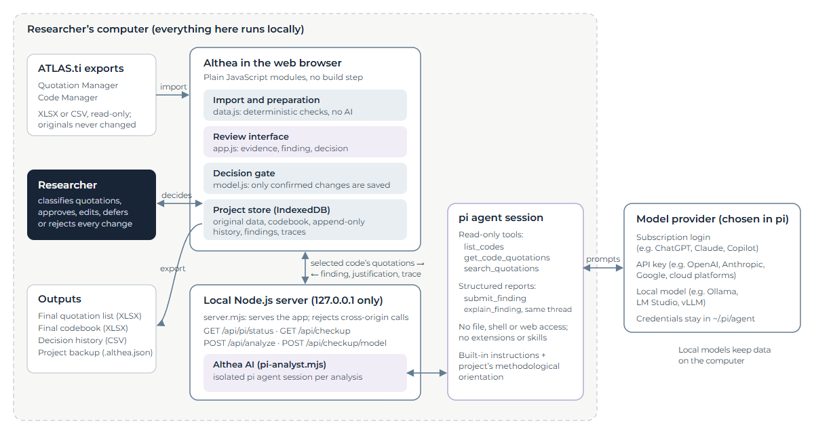</p>

<p align="center"><em><strong>Figure 1.</strong> System architecture. Everything inside the dashed frame runs on the researcher’s computer. Only the quotations of the selected code are sent to the model provider; with a local model, nothing leaves the computer.</em></p>

### 2.1 Components

| Component | Role |
|---|---|
| Import and preparation (`src/data.js`) | Reads XLSX or CSV exports, maps columns, builds quotations, codes and code assignments, and raises validation issues. Deterministic; no AI. |
| Review interface (`src/app.js`) | All screens: import, preparation, scope, review, confirmation, codebook, history and settings. |
| Decision gate (`src/model.js`) | Domain logic. `commitDecision` is the only function that changes codes or assignments, and it runs only after the researcher confirms. History is append-only. |
| Project store (`src/storage.js`) | Saves projects in the browser’s IndexedDB on the researcher’s computer. Projects move between computers as `.althea.json` backup files. |
| Local server (`server.mjs`) | Serves the application and the analysis endpoints. Listens only on 127.0.0.1 and rejects requests from other websites, so no other site can use the researcher’s model credentials. |
| Althea AI (`agent/pi-analyst.mjs`) | Runs one isolated pi agent session per analysis and returns a structured finding with its justification and trace. |
| pi agent and model provider | pi connects to the model the researcher has chosen: a subscription, an API key or a local model. Credentials are held by pi on the researcher’s computer, not by Althea. |

### 2.2 How an analysis runs

1. The researcher selects one code and one analytical function (for example, Verifying Coding) and starts the analysis.
1. The browser sends the quotations of the selected code, the code list and the project’s methodological orientation to the local server (`POST /api/analyze`). Quotations the researcher has removed from the dataset are left out.
1. The server starts a fresh, isolated pi agent session. The agent cannot read files, run commands or browse the web; pi’s extensions, skills and project instructions are switched off. It can only use three read-only tools over the payload: `list_codes`, `get_code_quotations` and `search_quotations`.
1. The agent reports its result through a structured tool, `submit_finding`, whose schema depends on the function: an overall rating, evidence summary, interpretation, confidence, suggestion, cited quotations and a classification of every quotation.
1. In the same session, the agent is then asked to explain its finding through a second tool, `explain_finding` (how it reached the finding, readings it set aside, what it is least certain about). Asking in the same thread means the model explains from what it actually read rather than reconstructing an explanation afterwards.
1. The server applies guard rails: citations of quotations outside the selected code are dropped, unclassified quotations are noted as a limitation, and the provenance label is set. It returns the finding, the justification and the reasoning trace.
1. The browser shows the finding next to the evidence. Nothing in the project changes until the researcher decides and confirms.

An analysis typically takes one to two minutes. The researcher can cancel it at any time; the server then stops the agent session.

### 2.3 Instructions given to the model

The built-in instructions define the task for each analytical function, require evidence to be cited by quotation ID, and ask the model to separate evidence, interpretation, confidence and suggestion. They can be viewed in Settings. The project’s methodological orientation is appended to these instructions; it never replaces them, because the instructions carry the reporting contract that the guard rails depend on.

## 3. Installation

### 3.1 System requirements

| Requirement | Details |
|---|---|
| Operating system | Windows 10 or 11, macOS |
| Node.js | Version 22.19 or newer (Althea itself needs Node.js 20 or newer; the pi agent needs 22.19 or newer). Download from https://nodejs.org. |
| Web browser | A current version of Chrome, Edge, Firefox or Safari. Private or incognito windows are not suitable, because projects are saved in the browser. |
| Git (optional) | To clone the repository. The repository can also be used as a ZIP file. |
| pi coding agent | Needed for Althea AI. Without it, import, preparation, manual review, the codebook and history all work, and a clearly labelled word-matching simulation can be run to try the workflow. |
| A model | One of: a subscription that pi can log in to (for example ChatGPT Plus or Pro, GitHub Copilot), an API key for a model provider, or a local model served by Ollama, LM Studio or vLLM. |
| Third-party packages | None. Althea has no npm dependencies and no build step. |

### 3.2 Install steps

#### Step 1. Get the source code

Clone the repository supplied with the submission, or unpack its ZIP file, and open a terminal in its folder:

```sh
git clone <repository-url> althea
cd althea
```

#### Step 2. Install the pi coding agent

On macOS:

```sh
curl -fsSL https://pi.dev/install.sh | sh
```

On Windows (PowerShell):

```powershell
powershell -c "irm https://pi.dev/install.ps1 | iex"
```

Or, on any system with Node.js, through npm:

```sh
npm install -g --ignore-scripts @earendil-works/pi-coding-agent
```

See the pi [Quickstart](https://pi.dev/docs/latest/quickstart) and, on Windows, the [Windows setup guide](https://pi.dev/docs/latest/windows).

#### Step 3. Connect pi to a model

Start pi once in a terminal, log in and choose a default model (see [section 3.3](#33-configuring-pi-subscriptions-api-keys-and-local-models)):

```sh
pi
/login      (choose a provider and sign in)
/model      (choose the default model)
```

#### Step 4. Start Althea

```sh
npm start
```

Then open http://127.0.0.1:4173 in the browser. On first launch Althea runs a system check ([section 3.4](#34-system-check)). To use another port, set the `PORT` environment variable. Keep using the same address and port: projects are saved per browser and address.

#### Step 5 (optional). Run the tests

```sh
npm test
```

This runs 39 tests over the example exports (import, preparation, decisions, exports and the trace format). The tests do not call a model.

### 3.3 Configuring pi: subscriptions, API keys and local models

Althea does not store model credentials. It uses whichever models pi is logged in to, and the researcher chooses the model and the thinking level in Althea’s Settings. pi’s documentation covers each option:

- **Existing subscription** (ChatGPT Plus or Pro through Codex, GitHub Copilot): use `/login` in pi. See [Providers: subscriptions](https://pi.dev/docs/latest/providers).
- **API key** (for example OpenAI, Anthropic, Google, or cloud platforms such as Azure, Bedrock or Vertex): set the provider’s environment variable or add the key to pi’s auth file. See [Providers: API keys and cloud providers](https://pi.dev/docs/latest/providers).
- **Local models** (Ollama, LM Studio, vLLM or any OpenAI-compatible server): add the server to `~/.pi/agent/models.json`. See [Choose a model](https://pi.dev/docs/latest/models) and [Custom models (models.json)](https://github.com/earendil-works/pi/tree/main/packages/coding-agent/docs/models.md).
- **Settings and full documentation**: [pi.dev/docs](https://pi.dev/docs/latest).

Optional environment variables for Althea: `ALTHEA_PI_MODEL=provider/model[:thinking]` overrides pi’s default model, and `ALTHEA_PI_SDK` points to a specific pi installation. Not every model offered by a subscription accepts requests from third-party tools; the system check’s model test (below) shows whether the chosen model answers.

Reasoning traces depend on the provider. Some providers return a readable summary of the model’s reasoning; others (for example OpenAI models used through a ChatGPT subscription) may return it encrypted or summarise it only sometimes, in which case the trace shows “not shared by the model provider” together with every tool the model used.

### 3.4 System check

On a fresh installation Althea runs a system check before the researcher starts a project, so that problems show up before any work depends on them. It checks browser storage, the spreadsheet reader and example files, the local server, Node.js, the pi agent, the pi login, and sends one short prompt to the chosen model. Each failed check states how to fix it. The check can be rerun from Settings.

<p align="center">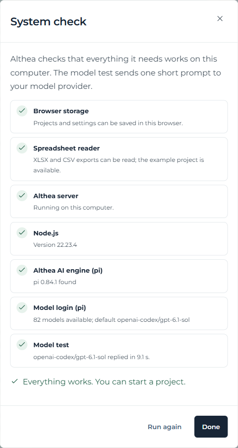</p>

<p align="center"><em><strong>Figure 2.</strong> The system check on first launch. All checks passed in this example.</em></p>

### 3.5 Troubleshooting

| Symptom | What to do |
|---|---|
| The browser cannot open http://127.0.0.1:4173 | Start Althea with `npm start` in the project folder and keep the terminal open. |
| “Althea AI engine (pi)” fails | Install pi so that the `pi` command works in a terminal, or set `ALTHEA_PI_SDK`. Restart Althea. |
| “Model login (pi)” fails | Run `pi`, log in with `/login` and pick a model with `/model`. |
| The model test fails | Choose another model in Althea’s Settings, or log in again in pi. Old API-key environment variables can make pi list models that will not work. |
| Settings say the server has no Althea AI support | An old server process is running. Stop it and run `npm start` again. |
| Browser storage fails | Allow site data for this address and do not use a private window. |

## 4. Researcher workflow

Althea guides the researcher through four stages (Import, Prepare, Scope and Review), with the Codebook and the decision History alongside. The stages follow the distinction made in the product specification between data input, data preparation, analysis, the researcher’s action, and the resulting change to the project data. The figures below use the example data supplied with the source code. The example exports contain coded interview excerpts from the creatives subset of the [Anthropic Interviewer dataset](https://huggingface.co/datasets/Anthropic/AnthropicInterviewer/viewer/AnthropicInterviewer/creatives) on Hugging Face.

### 4.1 Import

The researcher names the project and uploads the Quotation Manager and Code Manager exports from ATLAS.ti (XLSX or CSV), or loads the example project. Althea checks the required columns and shows a summary before anything is created. The original files are never changed.

<p align="center">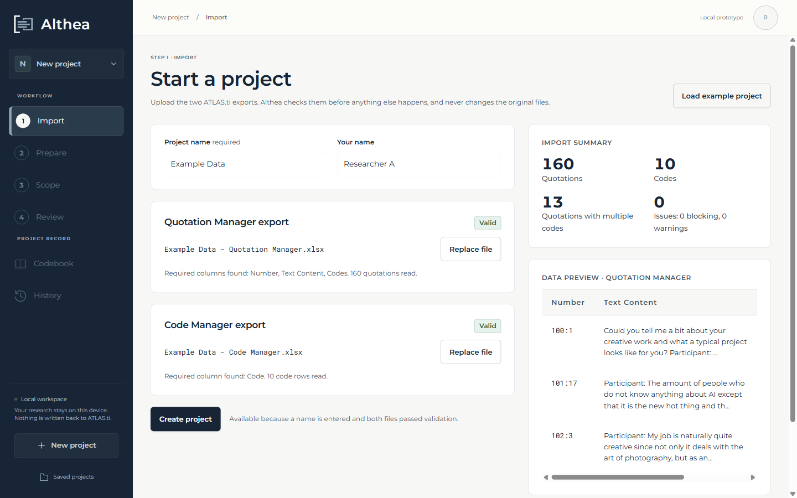</p>

<p align="center"><em><strong>Figure 3.</strong> Import. Both example exports passed validation: 160 quotations and 10 codes.</em></p>

### 4.2 Methodological orientation

When a project is created, Althea asks whether the researcher wants to set a methodological orientation: the epistemological and methodological assumptions that should guide the AI’s reading, such as how meaning, evidence, context and alternative interpretations are treated. The field starts empty. The researcher can write their own text or load an existing one: a built-in example (a constructivist orientation), the orientation of another project, or earlier instructions. The orientation is saved with the project and its backups, and recorded with each finding.

<p align="center">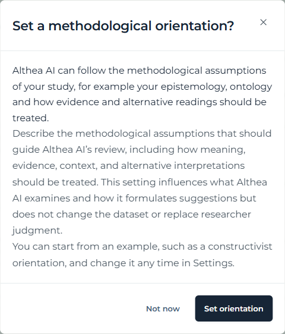</p>

<p align="center"><em><strong>Figure 4.</strong> After a project is created, Althea offers to set its methodological orientation.</em></p>

<p align="center">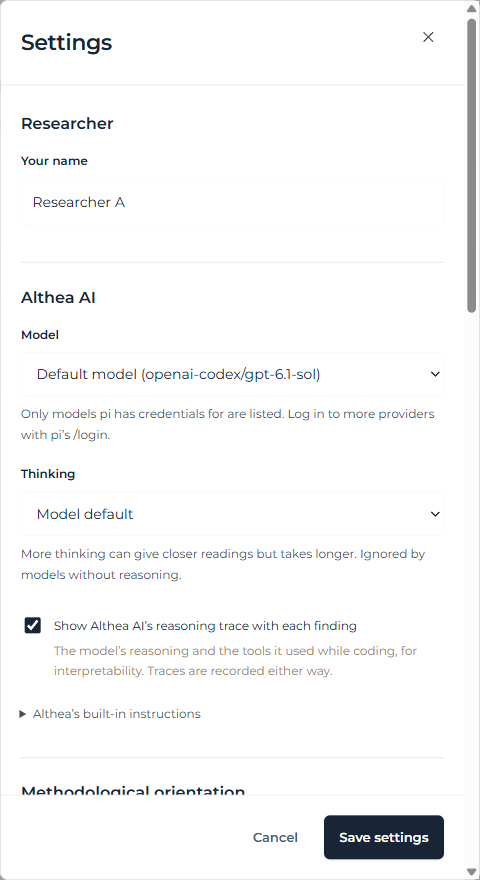</p>

<p align="center"><em><strong>Figure 5.</strong> Settings: researcher name, model, thinking level, and the option to show Althea AI’s reasoning trace with each finding.</em></p>

### 4.3 Prepare

Preparation turns the exports into one row per code–quotation pair (`quotation_per_code.csv`) and lists validation issues, such as inconsistent groundedness values or duplicates. The researcher marks each warning as Accepted, Resolved or Deferred. This step is data checking, not analysis, and uses no AI.

<p align="center">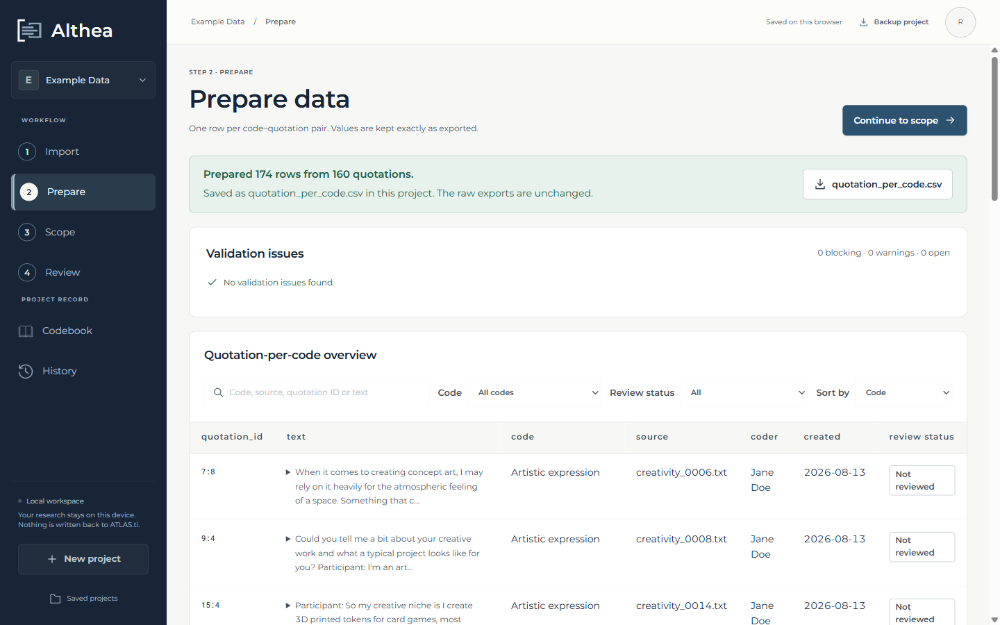</p>

<p align="center"><em><strong>Figure 6.</strong> Prepare. 174 rows were prepared from 160 quotations; the example data has no validation issues.</em></p>

### 4.4 Scope

The researcher chooses what to examine: one code and one of three analytical functions. Functions for several codes and for the whole dataset are specified and shown, but not yet available.

| Function | Question it addresses |
|---|---|
| Internal Code Coherence | Do the quotations of this code share one conceptual core, or do they form subgroups? |
| Verifying Coding | Do the quotations support the code’s label and its intended meaning? |
| Creating Code Definitions | What core concept and boundary rule (at most 50 words) describe this code? |

<p align="center">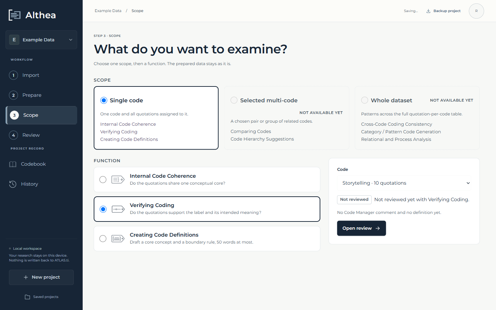</p>

<p align="center"><em><strong>Figure 7.</strong> Scope. The code “Storytelling” (10 quotations) is selected with the Verifying Coding function.</em></p>

### 4.5 Review

The review screen has two columns: the quotations on the left (“Reviewing the quotations”) and the code as a whole on the right (“Reviewing the code”). The researcher starts Althea AI from the right-hand column.

<p align="center">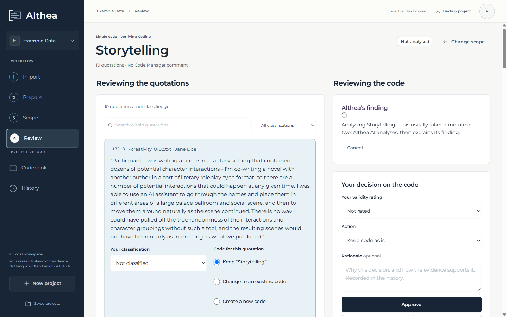</p>

<p align="center"><em><strong>Figure 8.</strong> Althea AI analyses the code and then explains its finding. A run usually takes one to two minutes and can be cancelled.</em></p>

Althea AI’s finding separates **evidence**, **interpretation**, **confidence** and **suggestion**, cites the quotations it rests on, and gives an overall rating. Each quotation card shows Althea AI’s reading of that quotation, and the researcher records their own classification and decides, per quotation, to keep it, move it to an existing or a new code, or remove it from the dataset (uncode).

<p align="center">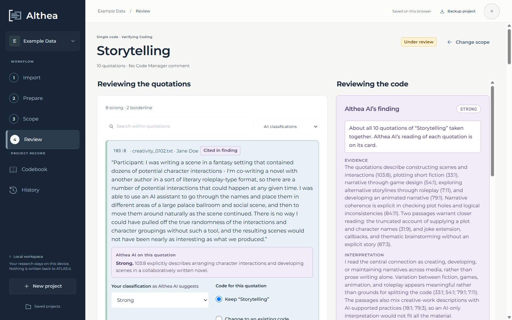</p>

<p align="center"><em><strong>Figure 9.</strong> Review. The quotations with Althea AI’s reading of each (left) and Althea AI’s finding on the code as a whole (right).</em></p>

<p align="center">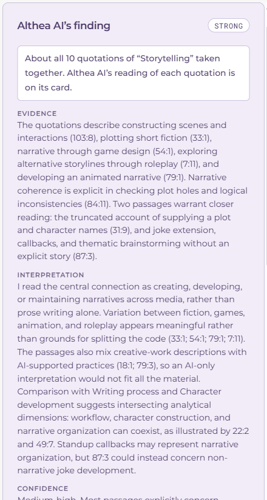</p>

<p align="center"><em><strong>Figure 10.</strong> Althea AI’s finding for “Storytelling”: rating, evidence, interpretation, confidence and suggestion, with links to the cited quotations.</em></p>

<p align="center">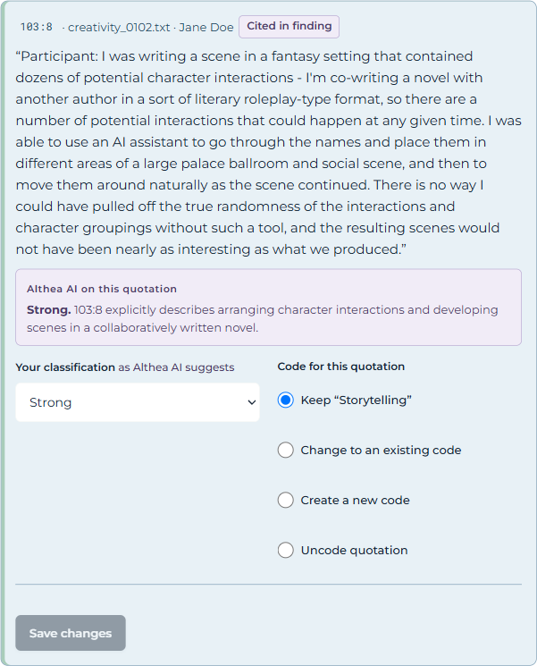</p>

<p align="center"><em><strong>Figure 11.</strong> A quotation card: Althea AI’s reading, the researcher’s classification, and the choice of code for the quotation.</em></p>

#### Interpretability: justification and reasoning trace

Under “Why Althea AI reached this finding”, the researcher can read the model’s own explanation, written in the same session immediately after it submitted the finding: how it reached the finding, which readings it set aside, and what it is least certain about. The interface states that this is the model’s explanation of its finding, written after the fact, and not a record of its internal reasoning, and asks the researcher to check it against the quotations.

<p align="center">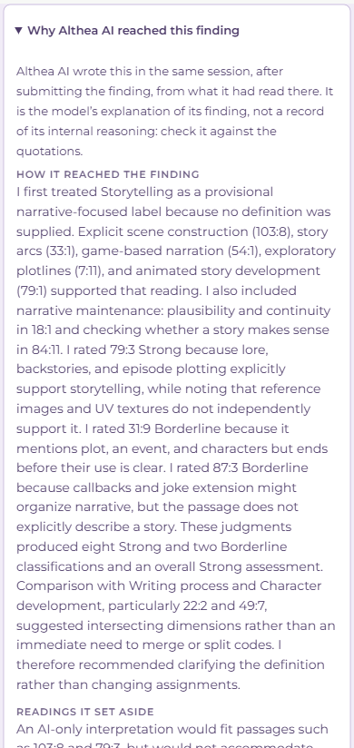</p>

<p align="center"><em><strong>Figure 12.</strong> Althea AI’s justification of its finding (partial view).</em></p>

If the researcher turns on “Show Althea AI’s reasoning trace” in Settings, the finding also shows the trace: the model’s reasoning where the provider shares it, each tool the agent used with its arguments, and shortened results. Traces are recorded for every finding whether or not they are shown.

<p align="center">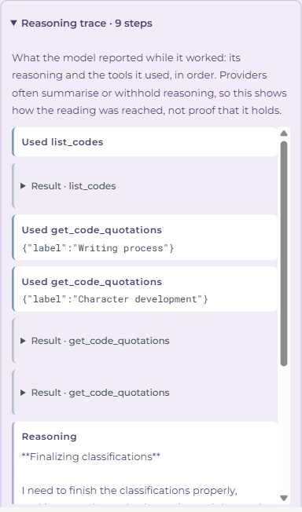</p>

<p align="center"><em><strong>Figure 13.</strong> The reasoning trace: tool calls (for example, retrieving the quotations of neighbouring codes for comparison) and the model’s reasoning steps.</em></p>

### 4.6 Decide and confirm

For the code as a whole, the researcher gives a validity rating, chooses an action (keep the code as it is, rename, refine the definition, create a subcode, retire, split, merge, or flag as borderline), and can add a rationale. They then approve, edit the suggestion, defer, or reject. Approving opens a confirmation screen that shows every change side by side with the previous values. Nothing is saved to the codebook until the researcher confirms.

<p align="center">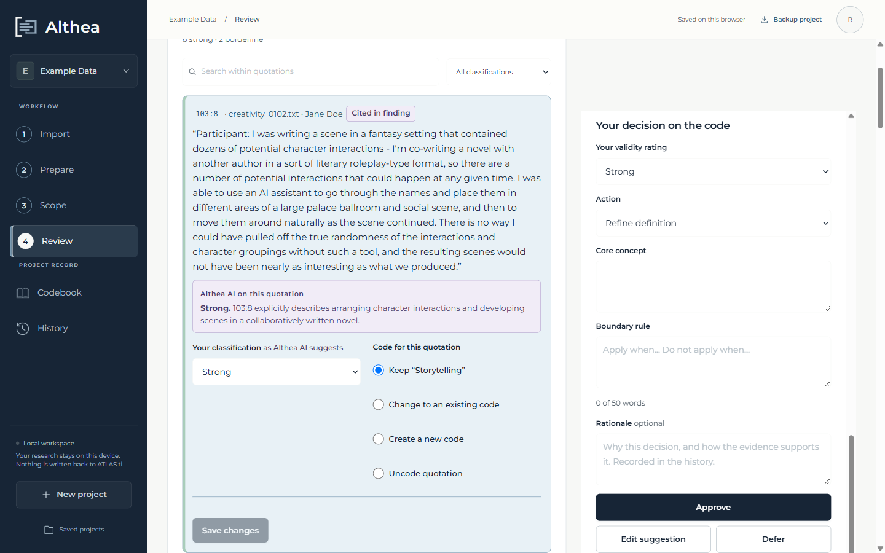</p>

<p align="center"><em><strong>Figure 14.</strong> The researcher’s decision on the code: rating, action, new definition and an optional rationale.</em></p>

<p align="center">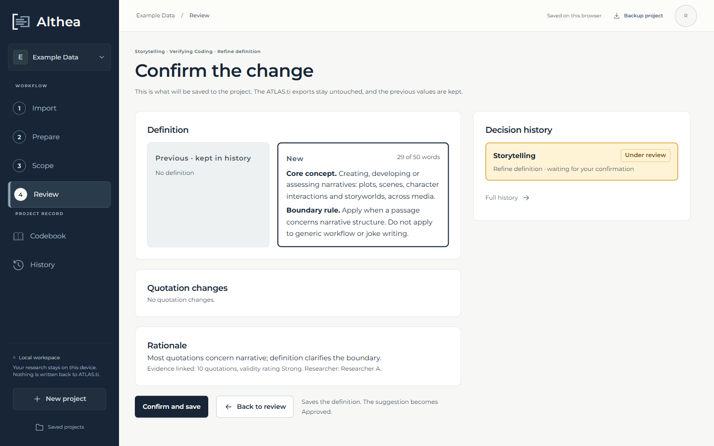</p>

<p align="center"><em><strong>Figure 15.</strong> Confirmation. The previous and the new definition are shown side by side; the previous values are kept in the history.</em></p>

### 4.7 Codebook and final files

The codebook shows the current codes with their definitions and review status. “Export final files” produces the final quotation list and the final codebook as XLSX files (with separate sheets for quotations removed from the dataset and for retired or merged codes), and the decision history and the quotation-per-code table as CSV files.

<p align="center">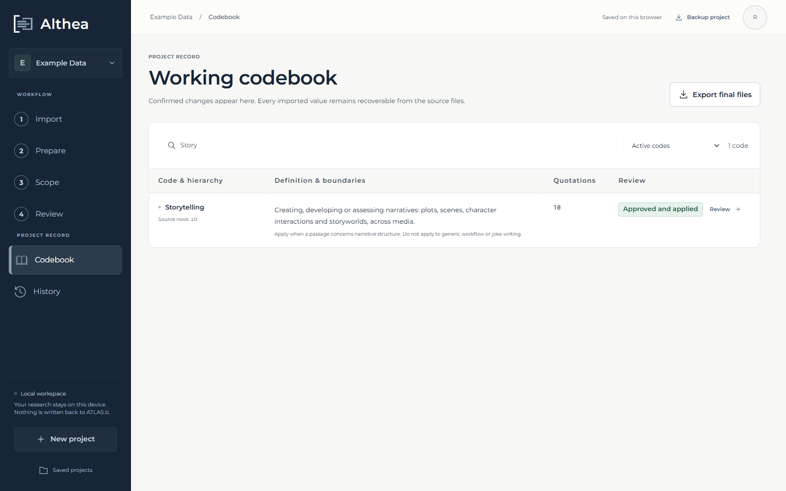</p>

<p align="center"><em><strong>Figure 16.</strong> The codebook after the decision: “Storytelling” now has a definition.</em></p>

<p align="center">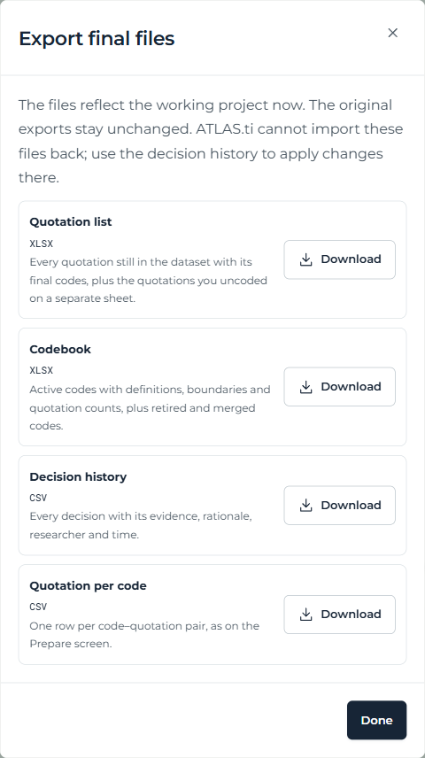</p>

<p align="center"><em><strong>Figure 17.</strong> Exporting the final files.</em></p>

### 4.8 Decision history

Every approved, deferred or rejected decision is kept with its evidence, rating, rationale, researcher and time, together with Althea AI’s finding, its provenance (including the model) and its justification. Deferred decisions can be reopened. The history can be exported as CSV.

<p align="center">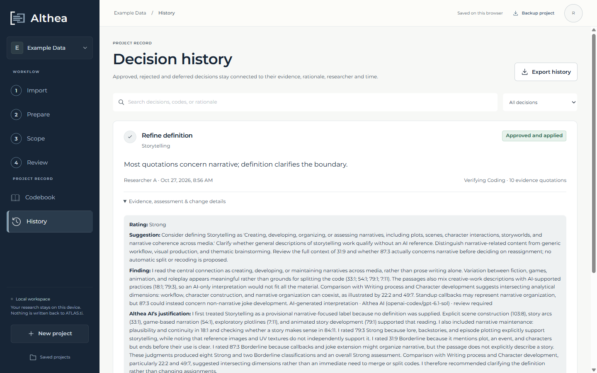</p>

<p align="center"><em><strong>Figure 18.</strong> The decision history, with the recorded finding and Althea AI’s justification.</em></p>

### 4.9 Saving and moving work

Projects are saved automatically in the browser on the researcher’s computer. “Backup project” downloads a `.althea.json` file with the project, its decisions, history and orientation. On another computer, the researcher starts Althea and chooses “Restore a project”; the original spreadsheets are not needed there.

## 5. Transparency, auditability and reproducibility

Althea records what is needed to understand and audit each AI-assisted decision after the fact:

| Recorded item | Where it is kept |
|---|---|
| Original exports and original coding | Kept unchanged in the project (`project.original`); the source files are never written to. |
| Model, thinking level and provider | On each finding and in its provenance label. |
| Methodological orientation | On the project and on each finding produced under it. |
| Finding, cited evidence and per-quotation readings | On the review and in the history. |
| Justification | On the finding (`finding.justification`), shown in the review and the history. |
| Reasoning trace | On the finding (`finding.trace`): reasoning where shared, tool calls, shortened results; at most 200 steps. |
| Researcher decision | Append-only history: action, rating, rationale, researcher, time, evidence and every change. |

Language model outputs are not deterministic, and providers update their models. Running the same analysis twice can therefore give different findings. Althea does not hide this: each finding records the model that produced it, and the researcher’s decision, not the model’s output, is what changes the codebook. The example data and the automated tests make the non-AI parts of the pipeline (import, preparation, decisions and exports) fully reproducible.

## 6. Data protection and research ethics

- Althea runs on the researcher’s computer. The application, the project data and the history are stored in the browser on that computer; there is no Althea server or account elsewhere.
- When Althea AI runs, the quotations of the selected code (and the list of code names) are sent to the model provider configured in pi. Researchers working with interview data should choose a provider whose data agreement fits their ethics approval, or use a local model so that no data leaves the computer.
- Model credentials are stored by pi on the researcher’s computer. The Althea server listens only on the local address and rejects requests from other websites.
- The AI agent has no access to files, the command line or the web; it sees only the data Althea sends for the analysis.
- The example data supplied with the source code is anonymised.

## 7. Limitations and planned work

- Only the three single-code functions are available. Comparing codes, code hierarchy suggestions and dataset-wide functions are specified but not yet implemented.
- Changes are not written back to ATLAS.ti. The final files can be used alongside the ATLAS.ti project, but cannot be re-imported into it.
- Althea is a single-researcher tool. Projects can be shared between researchers as backup files, but there is no simultaneous collaboration.
- The quality of findings depends on the model. Reasoning traces are only as complete as the provider allows.
- Althea AI needs the local server; there is no hosted version.
